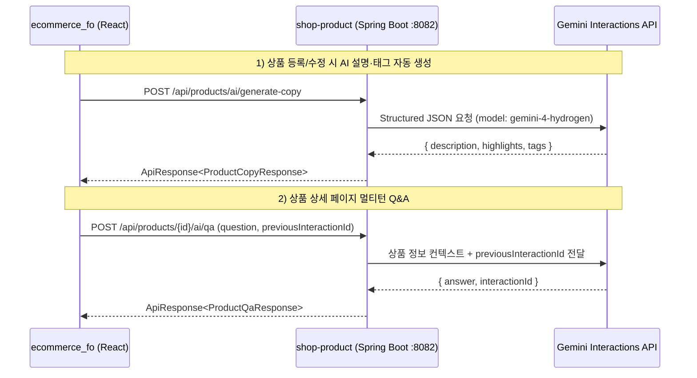

# Gemini API 연동 가이드 (`shop-product` + `ecommerce_fo`)

`shop-product` 백엔드에 Google Gen AI Java SDK(`com.google.genai:google-genai:2.6.0`)를 연동하여, **API 키를 프론트엔드에 노출하지 않고** 서버에서 Gemini API를 안전하게 호출하는 기능을 추가했습니다.

---

## 1. 무엇이 바뀌었나요? (Before → After)

| 구분 | 변경 전 (Before) | 변경 후 (After) |
| :--- | :--- | :--- |
| **`shop-product` API** | Kafka 주문 이벤트 수신(`decreaseStock`)만 존재, REST API 컨트롤러 없음 | `ProductController` 추가 (`/api/products` CRUD + Gemini AI 엔드포인트 3개) |
| **`Product` 엔티티** | `id`, `name`, `price`, `stockQuantity` | `sellerId`, `description`(상품 설명), `tags`(태그) 필드 추가 |
| **Gemini 연동** | 없음 | `GoogleGenAiGateway` + `ProductAiService` (Interactions API, 기본 모델 `gemini-4-hydrogen`) |
| **`ecommerce_fo` UI** | 상품명/가격/재고/판매자ID 수동 입력만 가능 | 상품 등록·수정 화면에 **AI 설명·태그 자동 생성**, 상세 화면에 **AI 멀티턴 Q&A** 추가 |

---

## 2. 동작 흐름



---

## 3. 추가된 백엔드 API (`http://localhost:8082`)

### 3-1. 상품 기본 CRUD
- `GET /api/products` — 전체 상품 목록 조회
- `GET /api/products/{id}` — 상품 단건 조회
- `POST /api/products` — 상품 등록 (`name`, `price`, `stockQuantity`, `sellerId`, `description`, `tags`)
- `PUT /api/products/{id}` — 상품 수정

### 3-2. Gemini AI 기능
1. **AI 상품 설명 · 태그 생성**: `POST /api/products/ai/generate-copy`
   ```json
   {
     "name": "프로 사운드 무선 이어폰",
     "price": 129000,
     "keywords": "노이즈캔슬링, 경량",
     "tone": "신뢰감 있고 친절한"
   }
   ```
   - 응답 `data`: `description` (상세 설명), `highlights` (핵심 포인트 배열), `tags` (검색 태그 배열)

2. **AI 상품 Q&A (저장된 상품 기준)**: `POST /api/products/{id}/ai/qa`
   ```json
   {
     "question": "재고가 얼마나 남았나요?",
     "previousInteractionId": "이전_대화_ID(선택)"
   }
   ```
   - 응답 `data`: `answer`, `interactionId` (다음 질문 시 `previousInteractionId`로 전달하면 문맥 유지)

3. **AI 상품 Q&A (인라인 컨텍스트)**: `POST /api/products/ai/qa`
   - DB 저장 전 미리보기 등 요청 본문에 `productName`, `price`, `stockQuantity`, `description`, `tags`를 직접 전달해 질문 가능

---

## 4. 변경된 주요 파일 목록

- 설정/의존성
  - `shop-product/build.gradle`: `com.google.genai:google-genai:2.6.0` 추가
  - `shop-product/src/main/resources/application.yml`: `gemini.api-key`, `gemini.model` 설정 추가
- 도메인/API
  - `shop-product/src/main/java/com/ecommerce/product/entity/Product.java`
  - `shop-product/src/main/java/com/ecommerce/product/dto/*.java`
  - `shop-product/src/main/java/com/ecommerce/product/service/ProductService.java`
  - `shop-product/src/main/java/com/ecommerce/product/controller/ProductController.java`
  - `shop-product/src/main/java/com/ecommerce/product/config/WebConfig.java`
- Gemini AI 계층
  - `shop-product/src/main/java/com/ecommerce/product/ai/GeminiProperties.java`
  - `shop-product/src/main/java/com/ecommerce/product/ai/GeminiInteractionGateway.java`
  - `shop-product/src/main/java/com/ecommerce/product/ai/GoogleGenAiGateway.java`
  - `shop-product/src/main/java/com/ecommerce/product/ai/ProductAiService.java`
- 테스트
  - `shop-product/src/test/java/com/ecommerce/product/ai/ProductAiServiceTest.java`
  - `shop-product/src/test/java/com/ecommerce/product/controller/ProductControllerTest.java`

---

## 5. 실행 및 테스트 방법

```powershell
# 1) 단위/컨트롤러 테스트 (API 키 없이 실행 가능)
.\gradlew.bat :shop-product:test

# 2) Gemini API 키 설정 후 shop-product 실행
$env:GOOGLE_API_KEY="YOUR_GEMINI_API_KEY"
.\gradlew.bat :shop-product:bootRun
```
